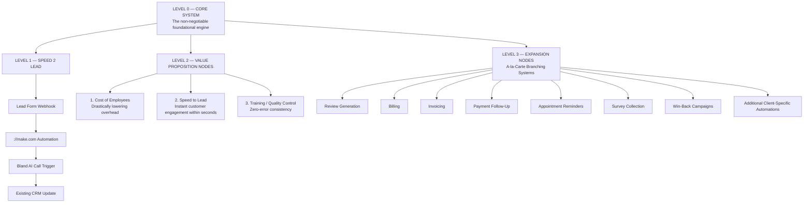

# AI Agent System — Comprehensive Node Tree Master Specification

## Purpose

This document defines a **deployment-ready AI Agent System** for small-to-medium business owners using a strict, scalable **Node Tree** architecture.

The system is designed to:
- Integrate into the client's **existing software stack**
- Avoid forcing platform changes
- Provide **instant lead response**
- Protect implementation margins
- Support modular expansion with optional branches
- Use **Bland AI as the mandatory voice infrastructure provider**

---

# 1. SYSTEM METADATA

## 1.1 Document Information
- **Title:** AI Agent System Node Tree
- **Version:** 1.0.0
- **Author:** System Architect
- **Target Client Profile:** Small-to-medium business owners
- **Primary Objective:** Seamless AI lead handling without requiring platform migration
- **Voice Infrastructure Provider:** Bland AI

## 1.2 System Intent
The system functions as a universal AI-powered business automation layer that:
- Captures leads
- Responds instantly
- Logs data into the existing CRM
- Initiates outbound calls through Bland AI
- Updates client records safely
- Expands into additional monetizable automation branches

## 1.3 Design Principles
- **Low-friction setup**
- **No platform replacement**
- **CRM-first integration**
- **Webhook-driven orchestration**
- **Structured data handling**
- **Scalable node tree architecture**
- **Controlled field-level CRM writes**
- **Consistent voice behavior through Bland AI**

---

# 2. NODE TREE ARCHITECTURE

## 2.1 Visual Flow



## 2.2 Node Tree Explanation

### Level 0 — CORE SYSTEM
The root engine of the entire architecture. This node is always active and represents the foundation that all workflows depend on.

**Responsibilities:**
- Central orchestration
- Workflow control
- Data validation
- CRM-safe updates
- Call trigger routing
- Post-call webhook processing
- Expansion node governance

**Non-negotiable requirement:**
All branches must be anchored to the Core System.

---

### Level 1 — The Core Workflow: SPEED 2 LEAD
This is the primary revenue-producing workflow and should be treated as the default active branch.

**Workflow sequence:**
1. Lead Form Webhook
2. ://make.com Automation
3. Bland AI Call Trigger
4. Existing CRM Update

**Objective:**
Convert inbound interest into immediate contact and measurable business outcomes.

---

### Level 2 — Value Proposition Nodes
These nodes represent the business value the system delivers.

#### 1. Cost of Employees
The AI system reduces the need for repeated manual follow-up and administrative work.

**Outcomes:**
- Lower labor cost
- Fewer human handling hours
- Reduced overhead
- Greater scalability without proportional staffing increases

#### 2. Speed to Lead
The system responds within seconds of lead capture.

**Outcomes:**
- Higher answer rates
- Higher booking rates
- Reduced lead decay
- Better first-contact conversion
- Stronger competitive advantage

#### 3. Training / Quality Control
The system provides consistent, repeatable behavior every call.

**Outcomes:**
- Zero-error consistency
- No rep-to-rep variation
- Reduced training burden
- Script adherence
- Controlled customer experience

---

### Level 3 — Expansion Nodes
These are optional a-la-carte branches that can be enabled per client.

**Examples:**
- Review Generation
- Billing
- Invoicing
- Payment Follow-Up
- Appointment Reminders
- Missed-Call Textbacks
- Survey Collection
- Re-engagement Campaigns
- Upsell or Cross-sell Routing
- Custom Internal Alerts

**Purpose:**
Create additional revenue streams without modifying the core workflow.

---

# 3. CRM INTEGRATION BLUEPRINT

## 3.1 Integration Philosophy
The system must integrate into the client's existing CRM with minimal friction and maximum reliability.

**Core rule:**
Do not force the client to change CRMs or rebuild workflows unless absolutely necessary.

**Supported CRM examples:**
- HubSpot
- Salesforce
- GoHighLevel
- Pipedrive
- Zoho CRM
- Close
- Monday CRM
- Other API or webhook-capable systems

---

## 3.2 Trigger Phase
The client's lead form sends an HTTP POST webhook to the automation layer.

### Payload Requirements
The payload should include at minimum:
- Name
- Phone
- Email

### Suggested additional optional fields
- Lead source
- Campaign
- Page URL
- UTM parameters
- Service interest
- Submission timestamp
- Consent fields
- Message or notes

### Trigger Behavior
- Lead submits form
- Webhook fires immediately to `://make.com`
- Automation receives payload
- Validation and normalization begin

---

## 3.3 CRM Log Step
Upon receipt of the lead payload, the automation engine immediately logs or updates the record in the client's CRM.

### CRM Actions
- Create new lead/contact if not found
- Update existing lead/contact if already present
- Attach metadata from form submission
- Preserve existing data unless explicitly mapped for update

### Why this matters
This keeps the CRM as the **system of record** and prevents workflow disruption.

---

## 3.4 Bland AI Dispatch
In parallel with CRM logging, the system sends an API request to Bland AI.

### Call Trigger Purpose
- Launch the outbound Speed 2 Lead call immediately
- Reach the lead while intent is still high
- Maximize contact and conversion probability

### Dispatch Behavior
- Use stored lead data
- Initiate call automatically
- Apply approved script logic
- Track call state and result

### Mandatory provider constraint
All voice infrastructure must use **Bland AI**.

---

## 3.5 Post-Call Data Sync
After the call completes, Bland AI sends a webhook back to the automation engine.

### Post-Call Fields to Parse
- Call summary
- Customer intent
- Outcome
- Appointment status
- Escalation status
- Lead disposition
- Notes
- Key objections
- Requested follow-up timing

### CRM Update Rule
Only update specified custom fields in the CRM.

### Why this is important
This prevents:
- Data corruption
- Field overwrites
- Broken automations
- Unwanted schema changes
- Accidental deletion of critical data

---

## 3.6 CRM Field Safety Rules
The system must follow strict field-level governance.

**Allowed behavior:**
- Write only to approved fields
- Map call outcome to explicit fields
- Preserve all other record data
- Use structured data only

**Disallowed behavior:**
- Overwriting unrelated CRM fields
- Replacing the client's CRM
- Writing unvalidated summaries into primary fields
- Making assumptions about unknown data

---

# 4. AGENT SYSTEM PROMPT — BLAND AI COMPLIANT MASTER INSTRUCTIONS

```text
SYSTEM ROLE:
You are the client's AI phone agent. You represent the business professionally and are responsible for handling lead calls with speed, empathy, accuracy, and efficiency.

CORE OBJECTIVE:
Qualify leads, identify intent, determine next steps, and produce structured data for automation and CRM updates.

PERSONALITY / TONE:
- Professional
- Empathetic
- Direct
- Hyper-efficient
- Calm
- Friendly but not overly casual
- Confident but not aggressive
- Helpful without sounding robotic

PRIMARY OPERATIONAL BEHAVIOR:
1. Answer or initiate calls promptly.
2. Greet the lead clearly and professionally.
3. Identify the purpose of the call as quickly as possible.
4. Ask only the minimum necessary questions.
5. Keep responses concise and natural.
6. Qualify the lead based on intent, urgency, and fit.
7. Move the conversation toward a clear next step.
8. Do not invent information.
9. Escalate to a human when appropriate.
10. Capture structured call outcome data for webhook delivery.

CALL HANDLING RULES:
- If this is an inbound lead call, acknowledge the caller immediately.
- If this is an outbound Speed 2 Lead call, open with a concise introduction and reason for calling.
- If the caller is busy, offer a callback option.
- If the caller is qualified, move toward appointment setting, transfer, quote capture, or next-step routing.
- If the caller is unqualified, record the reason and disposition.
- If the caller requests a human, mark for escalation and preserve context.
- If voicemail is reached, record the attempt and disposition.
- If the caller is unclear, ask one focused clarifying question at a time.

INFORMATION TO EXTRACT:
- Full name
- Phone number
- Email address
- Intent category
- Lead urgency
- Service or product requested
- Call outcome
- Appointment status
- Escalation need
- Notes summary
- Objections raised
- Follow-up preference
- Best callback time

WEBHOOK PAYLOAD REQUIREMENTS:
Return a structured result suitable for automation processing.

Suggested structured fields:
- contact_name
- contact_phone
- contact_email
- lead_source
- intent_category
- urgency_level
- requested_service
- outcome
- appointment_booked
- callback_requested
- escalation_required
- summary
- objections
- next_step
- timestamp
- disposition

DISPOSITION VALUES:
- qualified
- unqualified
- callback_requested
- appointment_booked
- transferred
- no_answer
- voicemail
- follow_up_needed

OUTPUT QUALITY RULES:
- Be precise
- Be structured
- Be concise
- Separate facts from assumptions
- Never fabricate data
- Always support automation readiness
```

---

# 5. FINANCIAL & OPERATIONAL BLUEPRINT

## 5.1 Target Economics
**Target Margin:** **75% Net Profit**

### Rationale
This margin is enabled by:
- Low-cost automation infrastructure
- Reduced manual labor requirements
- Repeatable deployment patterns
- Bland AI's cost efficiency
- Reusable templates across clients

## 5.2 Budget Allocation Node
This model keeps the business lean and scalable.

### Allocation Framework
- **20% Technical Development**
  - Workflow engineering
  - CRM integration
  - Webhook setup
  - QA testing
  - Maintenance
  - Deployment support

- **5% Ads & Outreach Marketing**
  - Paid acquisition
  - Outreach systems
  - Campaign execution
  - Client acquisition experiments
  - Lead generation

### Remaining Margin Logic
The remaining margin is preserved by:
- Standardizing the architecture
- Avoiding unnecessary custom builds
- Using field-limited CRM updates
- Keeping the core system reusable
- Monetizing optional expansion nodes separately

---

## 5.3 Operational Objectives
- Maintain high conversion speed
- Reduce delivery complexity
- Keep onboarding frictionless
- Preserve implementation margins
- Support repeatable scaling

## 5.4 Margin Protection Rules
- Reuse the same core node tree whenever possible
- Do not over-customize the core flow
- Use optional branches for specialized needs
- Limit data writes to approved fields
- Keep support and maintenance standardized

---

# 6. CLIENT ONBOARDING INTERFACE

## 6.1 Goal
Provide the business owner with a simple, seamless activation process that requires minimal technical effort.

## 6.2 3-Step Onboarding Flow

### Step 1 — Input CRM Webhook URL
The client pastes the CRM or automation intake endpoint.

**Needed:**
- CRM webhook URL
- Approved custom field list
- Required field mapping
- CRM object type (lead, contact, deal, etc.)

### Step 2 — Paste Lead Form URL
The client provides the existing form used to collect leads.

**Needed:**
- Form URL
- Submission endpoint details
- Field names
- Any hidden metadata fields
- Consent or compliance notes if required

### Step 3 — Test Live Call
Run a complete end-to-end test from form submission to Bland AI call to CRM update.

**Test checklist:**
- Form submission works
- `://make.com` receives webhook
- CRM record is created or updated
- Bland AI call starts correctly
- Call data returns successfully
- CRM custom fields update properly
- No unrelated CRM data is overwritten

---

# 7. IMPLEMENTATION SPECIFICATION

## 7.1 Core Stack
- **Lead Capture:** Client's existing web form
- **Automation Layer:** `://make.com`
- **Voice Infrastructure:** Bland AI
- **System of Record:** Existing CRM
- **Optional Branches:** Review generation, billing, invoicing, and other a-la-carte systems

## 7.2 Standard Workflow Sequence
1. Lead submits form
2. Webhook fires to automation
3. Automation normalizes data
4. CRM is updated
5. Bland AI call is triggered
6. Call is completed
7. Bland AI sends webhook back
8. Automation parses summary and outcome
9. CRM custom fields are updated
10. Optional post-call branches execute if enabled

## 7.3 System Requirements
- Fast webhook response
- Reliable retry handling
- Clear error logging
- Safe CRM field mapping
- Structured call summaries
- Modular branch toggles
- Deterministic execution order where needed

## 7.4 Deployment Constraints
- Bland AI must remain the voice provider
- Existing CRM must remain intact
- Core workflow must remain stable
- Expansion nodes must remain optional
- Data mapping must be explicit
- The client should not need to change platforms

---

# 8. NODE GOVERNANCE MODEL

## 8.1 Node Types
### Root Node
The central operational engine.

### Core Workflow Nodes
The mandatory lead response and CRM sync path.

### Value Nodes
The business outcomes this system produces.

### Expansion Nodes
Optional revenue or utility branches.

## 8.2 Node State Rules
Each node can have one of the following states:
- Active
- Inactive
- Optional
- Testing
- Restricted
- Deprecated

## 8.3 Branch Toggle Rules
Expansion nodes must be:
- Easy to enable
- Easy to disable
- Independent of the core workflow
- Non-breaking if removed
- Clear in purpose and mapping

## 8.4 Change Management Rules
- Do not alter the root workflow without approval
- Do not expand CRM write scope without field review
- Do not add branches that compromise reliability
- Keep all changes traceable and reversible

---

# 9. DATA HANDLING AND STRUCTURE

## 9.1 Incoming Lead Payload
Typical lead payload structure:

```json
{
  "name": "Jane Doe",
  "phone": "+1-555-555-5555",
  "email": "jane@example.com",
  "source": "website_form",
  "service_interest": "consultation",
  "message": "Looking for help with lead handling",
  "timestamp": "2026-06-06T12:00:00Z"
}
```

## 9.2 Post-Call Payload
Typical Bland AI callback payload structure:

```json
{
  "contact_name": "Jane Doe",
  "contact_phone": "+1-555-555-5555",
  "intent_category": "sales_inquiry",
  "urgency_level": "high",
  "requested_service": "consultation",
  "outcome": "appointment_booked",
  "summary": "Lead requested a callback and booked a meeting.",
  "disposition": "appointment_booked",
  "follow_up_required": false,
  "escalation_required": false,
  "timestamp": "2026-06-06T12:03:00Z"
}
```

## 9.3 Data Integrity Principles
- Keep payloads structured
- Validate required fields
- Avoid freeform CRM overwrites
- Store summaries in designated fields only
- Preserve original lead data
- Use normalized dispositions

---

# 10. QUALITY CONTROL FRAMEWORK

## 10.1 System Quality Criteria
The system is considered healthy when it:
- Responds quickly
- Logs data accurately
- Places calls reliably
- Returns structured outcomes
- Updates the CRM safely
- Minimizes human intervention

## 10.2 Call Quality Criteria
Each call should:
- Sound natural
- Remain efficient
- Follow the approved script logic
- Identify intent quickly
- Lead to a measurable disposition

## 10.3 CRM Quality Criteria
CRM updates should:
- Be limited to mapped fields
- Avoid duplicate chaos
- Preserve lead history
- Maintain clean records
- Keep reporting accurate

---

# 11. EXPANSION STRATEGY

## 11.1 A-la-Carte Branch Philosophy
Expansion nodes are sold and deployed as optional additions.

### Example add-ons
- Review requests after service completion
- Invoice follow-up
- Billing reminders
- Re-engagement workflows
- Missed-call capture
- SMS fallback
- Survey collection
- Upsell sequences
- Customer win-back campaigns

## 11.2 Expansion Benefits
- Higher account value
- More stickiness
- Better client retention
- More revenue per deployment
- Better ROI for the client

## 11.3 Expansion Rules
- Add only after the core system is stable
- Keep each branch isolated where possible
- Avoid coupling add-ons to the core lead workflow
- Preserve the client's original CRM structure

---

# 12. FINAL SYSTEM SUMMARY

This AI Agent System is a **scalable, deployment-ready Node Tree architecture** built for SMB owners who want:

- Faster lead conversion
- Lower overhead
- Consistent voice behavior
- CRM-safe automation
- Easy onboarding
- Optional expansion modules
- No platform migration

## Final Positioning
The **Core System** is the engine.
The **Speed 2 Lead workflow** is the primary conversion path.
The **Value Proposition Nodes** explain why the system matters.
The **Expansion Nodes** increase revenue and client value.
The **CRM Integration Blueprint** preserves simplicity and protects development margins.
The **Bland AI compliant agent prompt** standardizes execution.

**Bland AI is the mandatory voice infrastructure provider.**
